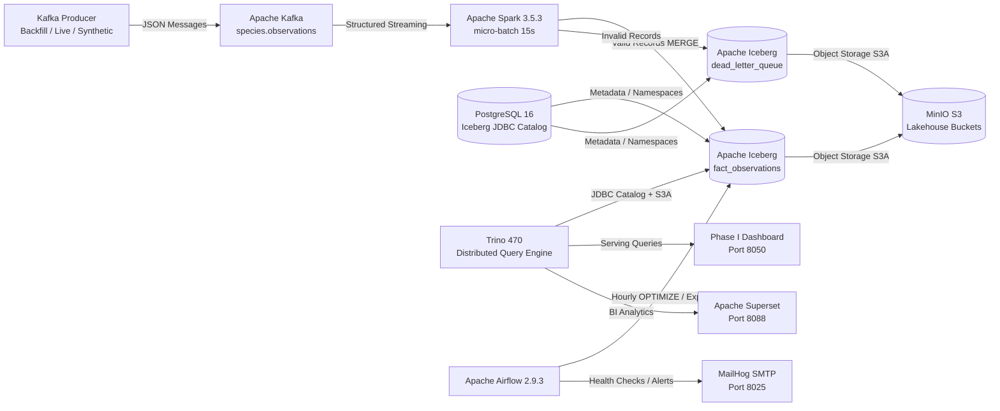

# Architectural Design Document: Real-Time Lakehouse

**Course**: 22MDCEL10 Data Engineering Laboratory  
**Project**: Phase II Production-Ready Real-Time Lakehouse Architecture

---

## 1. High-Level Architecture Overview

The system transitions the batch ETL process developed in Phase I into a modern real-time Lakehouse architecture supporting continuous ingestion, ACID transactions, time travel, schema evolution, and interactive SQL analytics.

---

## 2. Component Design Decisions

### 2.1 Storage & Catalog: Apache Iceberg on MinIO & PostgreSQL
- **Format**: Apache Iceberg table format v2 (supporting Merge-on-Read, row-level deletion, partition evolution).
- **Object Store**: MinIO (S3-compatible object storage) running locally.
- **Catalog**: PostgreSQL JDBC catalog (`lake.lakehouse`). Provides transactionally consistent metadata storage without the JVM memory overhead of running Apache Hive Metastore.
- **Partitioning Strategy**:
  - `month(observed_on)`: Prunes time-series queries without over-partitioning.
  - `iucn_status`: Prunes high-volume analytical aggregations by threat level.

### 2.2 Ingestion & Processing: PySpark Structured Streaming
- **Engine**: Apache Spark 3.5.3 with PySpark.
- **Trigger**: Micro-batch interval (15 seconds default) to balance latency with file size compaction.
- **Deduplication & Parity**:
  - Validates schema against strict Phase I boundaries.
  - Generates deterministic `record_hash` using SHA-256 (`id|observed_on|lat|lon|common_name`).
  - Uses Iceberg `MERGE INTO` on `record_hash` to guarantee idempotency and zero duplicates.
- **Dead-Letter Queue (DLQ)**: Invalid records (failing null checks, bounding box constraints, or media score limits) are diverted directly to `lake.lakehouse.dead_letter_queue` along with failure reasons and batch timestamps.

### 2.3 Query Serving: Trino 470
- **Engine**: Trino coordinator/worker in a single container with a tuned 2 GB JVM heap.
- **Integration**: Native Trino Iceberg connector reading metadata from the PostgreSQL JDBC catalog and data files from MinIO.
- **Views**: Exposes star schema compatibility views (`v_dim_species`, `v_dim_location`, `v_dim_time`, `v_cube`, `v_kpis`) so existing Phase I downstream consumers require zero schema alterations.

### 2.4 Orchestration & Reliability: Apache Airflow & MailHog
- **Maintenance**: Hourly `table_maintenance` DAG runs Iceberg `optimize` (small file rewrite), `expire_snapshots`, and `ANALYZE` for Trino cost-based optimizer statistics.
- **Health Checks**: 5-minute `pipeline_health` DAG verifies Trino availability, Spark streaming UI, and data freshness.
- **Alerting**: Dispatches failure alerts to local MailHog SMTP server.

---

## 3. Low-Memory Laptop Optimization

To allow smooth execution on an 8 GB–16 GB laptop (and Docker engines with ~3.5 GB allocated RAM):
- **docker-compose.lite.yml**:
  - Kafka: JVM heap clamped to 256 MB.
  - Trino: JVM heap clamped to 2048 MB (`-Xmx2G`).
  - Spark: Local executor with 1 core and 1.5 GB memory.
  - Superset: Disabled in lite mode (or single worker).
  - PostgreSQL & MinIO: Alpine/minimal Chainguard base images.
