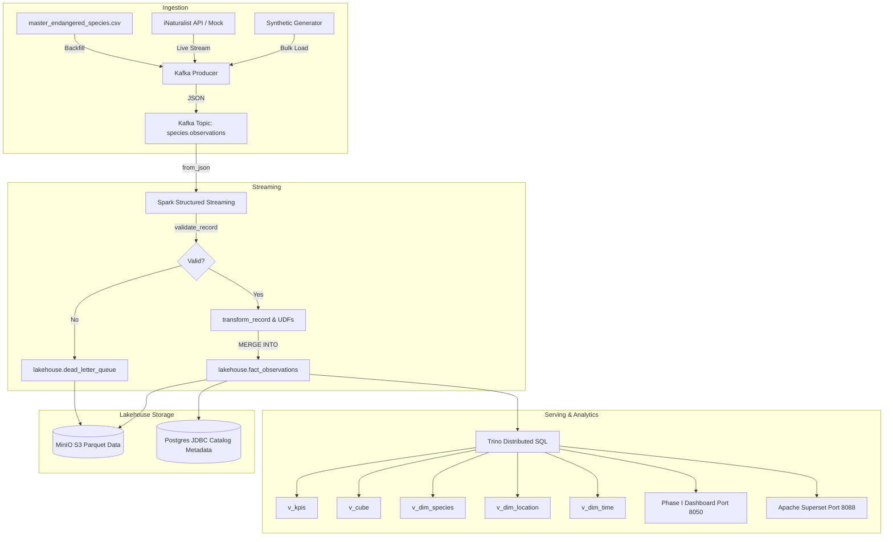

# Data Lineage and Column Mappings

**Course**: 22MDCEL10 Data Engineering Laboratory  
**Project**: Phase II Real-Time Lakehouse

---

## 1. End-to-End Lineage Flow

---

## 2. Column Lineage Table

| Input Field (Kafka / CSV) | Output Column (`fact_observations`) | Transformation / Business Rule | Target Type |
|---|---|---|---|
| `id` | `id_original` | Direct cast | `BIGINT` |
| `observed_on` | `observed_on` | ISO date extraction (`yyyy-MM-dd`) | `VARCHAR` |
| `observed_on` | `obs_year` | Extracted `year(observed_on)` | `INTEGER` |
| `observed_on` | `obs_month` | Extracted `month(observed_on)` | `INTEGER` |
| `observed_on` | `obs_day` | Extracted `day(observed_on)` | `INTEGER` |
| `observed_on` | `obs_day_of_week` | Day of week index (0=Mon, 6=Sun) | `INTEGER` |
| `observed_on` | `time_key` | `year * 10000 + month * 100 + day` | `INTEGER` |
| `observed_on` | `is_weekend` | 1 if day in (5, 6), else 0 | `INTEGER` |
| `season` | `season` | Standardized season string | `VARCHAR` |
| `quality_grade` | `quality_grade` | Cleaned quality grade string | `VARCHAR` |
| `data_quality_flag` | `data_quality_flag` | Cleaned data quality flag | `VARCHAR` |
| `gps_precision` | `gps_precision` | Missing values imputed with `'Medium (≤100m)'` | `VARCHAR` |
| `place_guess` | `place_guess` | Location description string | `VARCHAR` |
| `place_guess` | `state_province` | Indian state match or `'Other Region'` / `'Unknown Region'` | `VARCHAR` |
| `country` | `country` | Fixed to `'India'` | `VARCHAR` |
| `latitude` | `latitude` | Bounded float in range `[6.0, 38.0]` | `DOUBLE` |
| `longitude` | `longitude` | Bounded float in range `[68.0, 98.0]` | `DOUBLE` |
| `latitude` | `lat_normalized` | Round `(lat - 8.0) / (35.0 - 8.0)` to 6 decimals | `DOUBLE` |
| `longitude` | `lon_normalized` | Round `(lon - 68.0) / (97.0 - 68.0)` to 6 decimals | `DOUBLE` |
| `common_name` | `common_name` | Direct string | `VARCHAR` |
| `scientific_name` | `scientific_name` | Direct string | `VARCHAR` |
| `animal_category` | `animal_category` | Direct category classification | `VARCHAR` |
| `animal_category` | `iucn_status` | Mapped via `IUCN_MAP` dictionary | `VARCHAR` |
| `media_score` | `media_score` | Integer in range `[0, 10]` | `INTEGER` |
| *(composite)* | `record_hash` | SHA-256 of `id\|observed_on\|latitude\|longitude\|common_name` | `VARCHAR` |
| *(system)* | `ingestion_ts` | Spark processing batch ingestion timestamp | `TIMESTAMP` |
